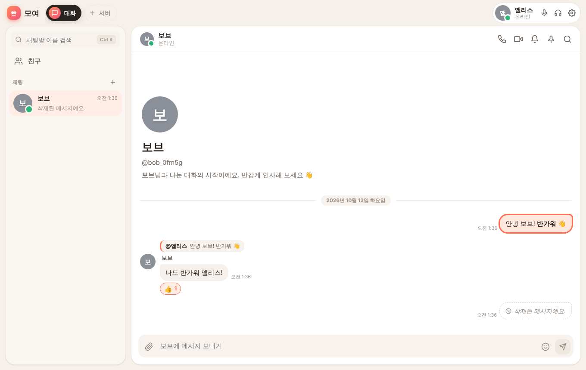
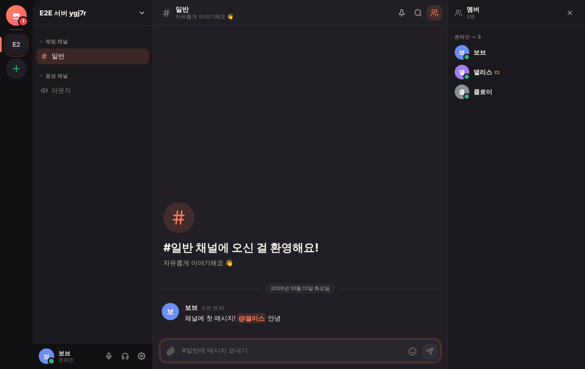
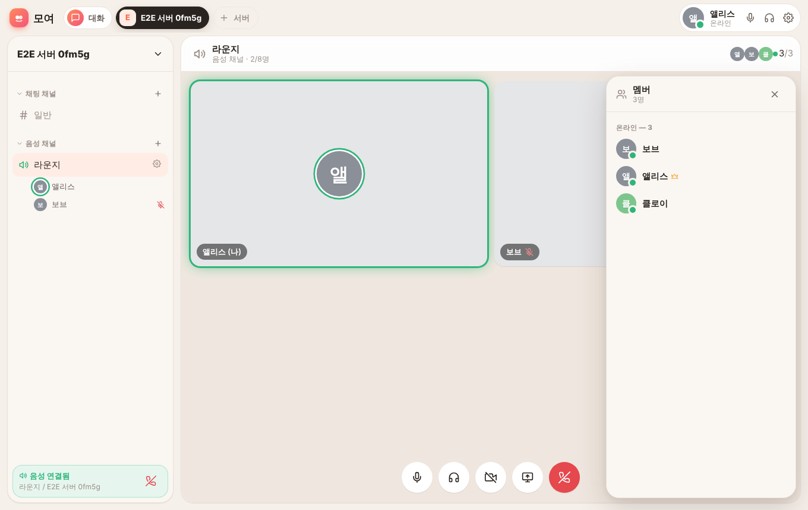
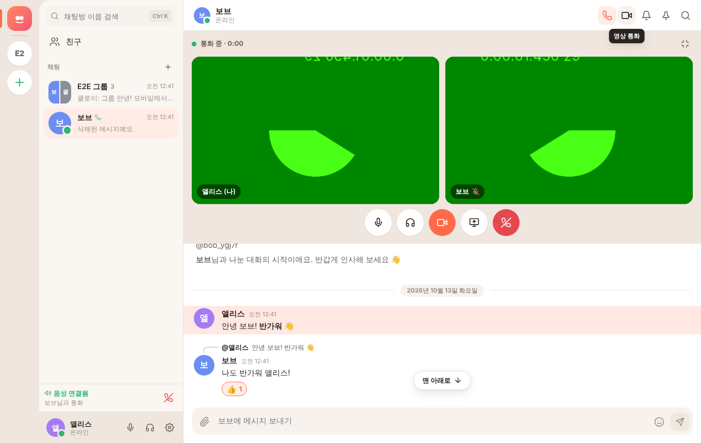
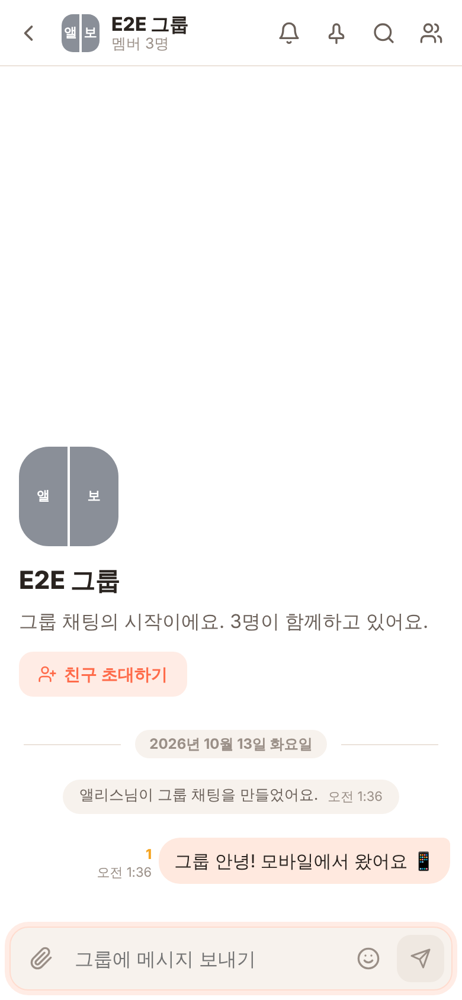
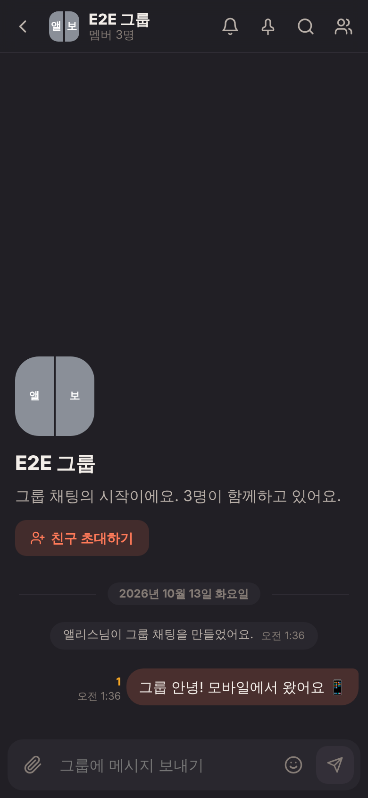
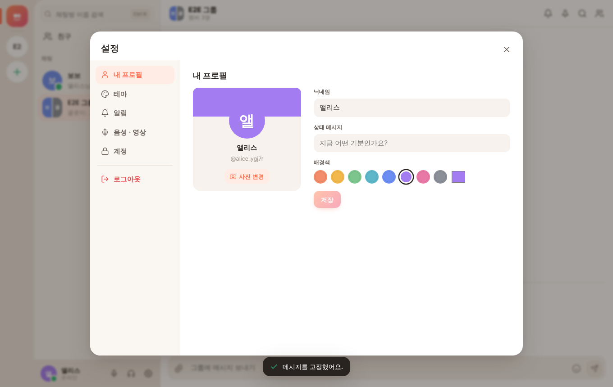

# 모여 (Moyeo)

> 좋아하는 사람들과 언제든 모여요 — 1:1 대화, 그룹 채팅, 커뮤니티 서버, 음성·영상 통화를 하나로.

**모여**는 친근한 메신저(1:1·그룹 채팅)와 커뮤니티(서버·채널·역할·음성방)를 합친 실시간 소통 웹앱입니다.
한 대의 컴퓨터에서 서버를 켜면 **같은 와이파이의 친구들이 바로 접속해서** 채팅하고 통화할 수 있습니다.

| 데스크톱 (라이트) | 데스크톱 (다크) |
| --- | --- |
|  |  |
|  |  |

| 모바일 | 모바일 (다크) | 설정 |
| --- | --- | --- |
|  |  |  |

---

## 빠르게 시작하기

필요한 것: **Node.js 20 이상** (22 권장), npm

```bash
npm install        # 서버·클라이언트·공용 패키지를 한 번에 설치
npm run seed       # (선택) 체험용 데모 데이터 만들기
npm run dev        # 서버 + 클라이언트 동시 실행
```

브라우저에서 **http://localhost:5173** 을 엽니다.

`npm run seed`를 실행했다면 아래 계정으로 바로 로그인해 볼 수 있어요. 비밀번호는 모두 **`moyeo1234`** 입니다.

| 아이디 | 닉네임 | 메모 |
| --- | --- | --- |
| `minji` | 민지 | 모두와 친구, '퇴근 후 코딩 클럽' 서버 소유자 |
| `junho` | 준호 | '보드게임 동호회' 서버 소유자 |
| `seoyeon` | 서연 | 디자이너 역할 |
| `dohyun` | 도현 | 운영진 역할, 하은의 친구 요청 대기 중 |
| `haeun` | 하은 | 막 가입한 새싹 |

데모 데이터에는 DM 대화, 그룹 채팅(고정 메시지 포함), 서버 2개(카테고리·역할·스레드·반응 포함)가 들어 있습니다.
> ⚠️ `npm run seed`는 기존 데이터베이스를 지우고 새로 만듭니다. 서버를 끈 상태에서 실행하세요.

### 운영 모드로 실행

```bash
npm run build      # 클라이언트 빌드 (client/dist)
npm start          # 하나의 포트(3001)에서 API + 화면을 함께 제공
```

---

## 친구와 같이 쓰기 (같은 와이파이)

`npm run dev`(또는 `npm start`)를 실행하면 콘솔에 접속 주소가 표시됩니다.

```
  ────────────────────────────────────────────────────────────────
   🫶  모여(Moyeo) 서버가 시작됐어요!  (개발 모드)
  ────────────────────────────────────────────────────────────────
   이 컴퓨터에서         →  http://localhost:5173

   같은 와이파이의 친구는 아래 주소로 접속하세요:
     📞 통화까지  →  https://192.168.0.12:5443   (인증서 경고 → '고급' → '계속')
     💬 채팅만    →  http://192.168.0.12:5173
  ────────────────────────────────────────────────────────────────
```

1. 친구의 휴대폰/노트북이 **같은 와이파이**에 연결되어 있는지 확인합니다.
2. 친구에게 **`https://<내 IP>:5443`** 주소를 알려 줍니다.
3. 처음 접속하면 "연결이 비공개로 설정되어 있지 않습니다" 같은 **인증서 경고**가 나옵니다.
   모여가 자동으로 만든 자체 서명 인증서라서 그래요. **고급 → (주소)로 이동(안전하지 않음)** 을 누르면 됩니다.
4. 회원가입 후 서로 **아이디로 친구 추가**하거나, 서버의 **초대 링크**를 공유하면 끝!

**왜 HTTPS 주소가 따로 있나요?** 브라우저는 보안상 `localhost`나 HTTPS 주소에서만 마이크·카메라를 허용합니다.
그래서 다른 기기에서 음성/영상 통화를 하려면 HTTPS 주소(5443 포트)로 접속해야 해요. 채팅만 할 거라면 `http://<IP>:5173`도 됩니다.

**접속이 안 되면?**
- 컴퓨터의 방화벽이 5173 / 5443 (운영 모드는 3001 / 5443) 포트를 막고 있지 않은지 확인하세요. (Windows는 처음 실행 시 "액세스 허용"을 눌러 주세요.)
- 회사/학교 와이파이는 기기끼리의 통신을 막아 두는 경우가 있어요(AP 격리). 집 와이파이나 휴대폰 핫스팟에서 시도해 보세요.

---

## 기능

### 계정과 친구
- 회원가입 / 로그인 / 로그아웃 (argon2id 비밀번호 해시, httpOnly 쿠키 세션)
- 프로필: 사진 업로드(원형 크롭 편집기 → 서버에서 256px WebP로 리사이즈), 닉네임, 상태 메시지, 배경색
- 접속 상태: **온라인 / 자리 비움(5분 동안 입력이 없으면 자동) / 방해 금지 / 오프라인으로 표시** — 실시간 반영
- 아이디로 친구 요청 → 수락/거절/취소, 친구 삭제, 차단/해제, 친구 목록(온라인 우선 정렬), 이름 검색

### 채팅 (DM · 그룹)
- 1:1 DM, 그룹 채팅(최대 50명) — 친구 초대(**받은 사람이 수락해야 참여**, 거절 가능), 나가기, 방 이름·방 사진 변경
- 채팅 목록: 마지막 메시지 미리보기, 시간, 안 읽은 수 배지, **상단 고정**, **알림 끄기**, 실시간 정렬, 입력 중 미리보기
- **읽음 표시**: 메시지 옆에 아직 안 읽은 사람 수(카카오톡처럼), 읽으면 실시간으로 줄어듦
- **입력 중 표시**: "OO님이 입력 중…", 여러 명이면 "OO님 외 N명이 입력 중"
- 답장(원문 인용, 클릭 시 원문으로 스크롤 + 하이라이트), 수정("수정됨" 표시), 모두에게서 삭제,
  이모지 반응(누가 눌렀는지 툴팁), 텍스트 복사, `@닉네임` 멘션 자동완성 + `@모두`, 메시지 고정
- 서식: 입력창의 **MD 버튼**을 켜고 보낸 메시지는 마크다운으로 표시 — `# 제목`, `- 목록`/`1. 번호 목록`(중첩), `- [ ] 체크리스트`, **표**(넓으면 가로 스크롤), `---` 구분선, `> 인용`, ```` ```코드 블록``` ````(자체 구문 강조), `**굵게**`·`*기울임*`·`~~취소선~~`·`` `코드` ``, `[텍스트](링크)`. 보내기 전 **미리보기** 가능.
  MD를 끄고 보낸 메시지는 쓴 글자 그대로 보여요(멘션·링크 자동 인식만). 외부 이미지 ``는 보는 사람 추적을 막기 위해 불러오지 않아요. 모든 서식은 HTML 삽입 없이 그려 XSS에 안전해요.
- 이미지/파일: **드래그 앤 드롭, 클립보드 붙여넣기**, 업로드 진행률, 이미지 미리보기 + 라이트박스, 동영상/음성 재생, 25MB·10개 제한, 형식 검증
- 이모지 피커: 카테고리, 한국어 검색("하트", "웃음"…), 최근 사용
- 연속 메시지 묶기, 날짜 구분선, "여기부터 새 메시지" 구분선
- 무한 스크롤(커서 기반 페이지네이션), 새 메시지가 오면 하단에 "새 메시지 N개" 버튼
- 대화 내 메시지 검색(키워드 + 보낸 사람 필터), 결과 클릭 시 그 위치로 이동
- **전송 실패 시 재시도/삭제 버튼**, **오프라인에서 보낸 메시지는 재연결 후 순서대로 자동 전송** (낙관적 UI + 클라이언트 임시 ID로 중복 방지)

### 서버와 채널 (커뮤니티)
- 서버 만들기(이름, 아이콘) — 기본 채팅 채널 `#일반`과 음성 채널 `라운지`가 함께 만들어짐
- 초대 링크: 만료 시간(30분~7일/무제한), 사용 횟수 제한, 링크 미리보기 후 참가, 초대 목록 관리
- 카테고리별 텍스트/음성 채널, **드래그 앤 드롭으로 채널·카테고리 순서 변경**, 카테고리 접기
- 역할과 권한: 역할 만들기(이름, 색상), 10가지 권한, 역할 순서(위계), 멤버에게 역할 부여, **닉네임 색은 최상위 역할 색**
- 멤버 목록 사이드바: 역할별 그룹 + 온라인/오프라인 구분, 우클릭으로 DM/역할 관리/추방
- **차단 목록(블랙리스트)**: 추방하면 그 계정이 자동으로 서버 차단 목록에 올라가 예전 초대 링크든 새 링크든 다시 들어올 수 없음. 아직 멤버가 아닌 계정도 아이디로 미리 차단 가능, 서버 설정 → `차단 목록`에서 해제
- 채널별 안 읽음 표시, 멘션 배지, 서버 아이콘에 안 읽음 점/멘션 수
- 스레드: 메시지에서 스레드를 열어 오른쪽 패널에서 대화, 원래 메시지에 "답글 N개" 표시

### 음성 · 화상
- 음성 채널 입장 시 WebRTC 메시 연결 (최대 8명), 시그널링은 Socket.IO
- 1:1 DM에서 **음성/영상 통화 걸기 · 받기 · 거절**, 부재중/거절/통화 시간 기록
- 마이크 음소거, 스피커 끄기, 카메라 켜기/끄기, **화면 공유**
- **말하는 사람 테두리 강조** (Web Audio 음량 분석)
- 입력/출력/카메라 장치 선택, 마이크 테스트, 카메라 미리보기
- 입장/퇴장/음소거/벨소리 효과음 — 오디오 파일 없이 Web Audio로 즉석 생성

### 알림
- 브라우저 알림(권한 요청 배너/설정), **창이 비활성일 때만** 표시, 클릭하면 해당 대화로 이동
- 탭 제목에 안 읽은 수 `(3) 모여`, 메시지 수신음 (설정에서 끄기 가능)
- 방해 금지 상태이거나 알림을 끈 방은 소리·알림 없음. 서버 채널은 나를 멘션했을 때만 알림

### 화면 · 사용성
- 데스크톱: 위쪽 **스페이스 탭 바**(대화 · 서버들 · 내 정보) 아래에 목록 카드와 대화 카드가 떠 있는 구조. 멤버·스레드·검색·고정은 필요할 때 여는 **서랍**
- 메시지는 **말풍선** (내 메시지는 오른쪽, 안 읽은 사람 수와 시간은 말풍선 옆)
- 모바일(768px 이하): 목록 ↔ 대화창 ↔ 패널 슬라이드 전환, 길게 눌러 메시지 메뉴, 바텀 시트 모달, 터치 친화적 크기
- 설정: 내 프로필, 테마(라이트/다크/시스템), 알림, 음성·영상 장치, 계정(비밀번호 변경, 로그아웃)
- 단축키: **Ctrl/⌘ + K** 빠른 이동(한글 초성 검색 지원), **Esc** 답장 취소, **↑** 내 마지막 메시지 수정, **Enter** 보내기 / **Shift+Enter** 줄바꿈
- 빈 상태 일러스트, 로딩 스켈레톤, 한국어 토스트 오류 안내

## 인터넷에 배포하기 (다른 와이파이에서도 대화)

같은 와이파이가 아니어도 쓰려면 서버를 인터넷에 올리면 됩니다. 저장소에 **Render 무료 플랜용 원클릭 배포 설정(`render.yaml`)**이 들어 있어요.

### Render에 무료로 배포

1. [render.com](https://render.com)에 **GitHub 계정으로 가입**합니다. 무료 플랜은 카드 등록 없이 쓸 수 있어요.
2. 대시보드에서 **New → Blueprint**를 누르고 이 저장소를 고릅니다.
   (저장소가 안 보이면 "Configure GitHub App"에서 이 저장소 접근을 허용해 주세요.)
3. 모여 코드가 있는 브랜치를 선택하고 **Apply**를 누릅니다.
4. 몇 분 뒤 `https://moyeo-xxxx.onrender.com` 같은 **실제 주소**가 생깁니다. 이 주소를 친구에게 보내면 어디서든 가입하고 대화할 수 있어요.
   - 체험용 계정이 필요하면 환경 변수 `MOYEO_DEMO`를 `1`로 바꾸세요 (비밀번호 `moyeo1234`).

> **무료 플랜에서 알아 둘 점**
> - 15분 정도 아무도 접속하지 않으면 서버가 **잠들어요.** 다음 접속 때 깨어나느라 첫 화면이 30초~1분쯤 걸릴 수 있어요.
> - 무료 플랜은 디스크가 없어서, 잠들었다 깨어나거나 재배포되면 서버 안의 파일이 초기화돼요.
>   **아래처럼 Firebase 백업을 켜 두면 계정·대화·사진이 그대로 유지됩니다.** (켜지 않으면 그때마다 다시 가입해야 해요)
> - 음성·영상 통화는 같은 와이파이에서는 되지만, 서로 다른 네트워크끼리는 TURN 서버(아래 환경 변수 표 참고)가 있어야 안정적으로 연결돼요. 채팅만 쓴다면 필요 없어요.

### 계정·대화 유지하기: Firebase 백업 (무료)

서버는 그대로 Render에서 돌고, 데이터베이스 전체와 업로드 파일을 **Firebase Firestore에 자동 백업**합니다.
변경이 있으면 최대 30초마다 저장하고(바뀐 게 없으면 아무것도 쓰지 않음), 서버가 시작될 때 백업에서 복원해요.

1. [Firebase 콘솔](https://console.firebase.google.com)에서 프로젝트를 고릅니다.
   **모여 전용 프로젝트를 새로 만드는 걸 추천해요.** 아래 2번의 키는 그 프로젝트 전체에 대한 관리자 권한이라, 다른 작품과 분리해 두는 게 안전합니다.
2. 왼쪽 메뉴 **빌드 → Firestore Database → 데이터베이스 만들기** (위치는 `asia-northeast3 (서울)` 추천, 모드는 "프로덕션 모드").
3. **프로젝트 설정(톱니바퀴) → 서비스 계정 → 새 비공개 키 생성**을 눌러 JSON 파일을 내려받습니다.
4. Render 대시보드 → moyeo 서비스 → **Environment** → `FIREBASE_SERVICE_ACCOUNT` 값에 **JSON 파일 내용 전체를 그대로 붙여넣고** 저장합니다. (자동으로 재배포돼요)
5. Render 로그에 `💾 데이터 백업: Firebase Firestore`가 보이면 성공이에요. 이제 서버가 재시작돼도 계정이 유지됩니다.

- Firestore에는 `moyeo`(데이터베이스), `moyeo_files`(업로드 파일) 두 컬렉션만 만들어요. 이름은 `FIREBASE_COLLECTION` 환경 변수로 바꿀 수 있어요.
- 비밀번호는 원문이 아니라 되돌릴 수 없는 해시(argon2)로만 저장돼요.
- 무료(Spark) 요금제 한도 안에서 쓰도록, 변경이 없을 때는 쓰기를 하지 않고 최대 30초 간격으로 모아서 저장합니다.
- 서버가 백업을 읽지 못하면(키 오류, 일시적인 장애) 몇 번 다시 시도하고, 그래도 안 되면 **기존 백업을 덮어쓰지 않도록** 그 실행에서는 백업 저장을 멈추고 로그에 알려 줍니다.
- 키 파일은 비밀번호처럼 다뤄 주세요. 저장소(GitHub)에 올리면 안 돼요.

### 다른 호스팅 (Railway, Fly.io, 개인 서버)

`Dockerfile`이 들어 있어요. 컨테이너의 `3001` 포트를 공개하고, 데이터 보관용 볼륨을 `/data`에 연결하세요.
공개 주소를 `PUBLIC_URL` 환경 변수로 알려 주면 로그에 표시됩니다. HTTPS는 호스팅 서비스가 처리합니다.

```bash
docker build -t moyeo .
docker run -p 3001:3001 -v moyeo-data:/data moyeo
```

---

## 명령어

| 명령 | 설명 |
| --- | --- |
| `npm run dev` | API 서버(3001) + Vite 개발 서버(5173) + HTTPS 게이트웨이(5443) 동시 실행 |
| `npm run seed` | 데모 계정 5개, 서버 2개, 대화 기록 생성 (DB 초기화) |
| `npm run migrate` | DB 마이그레이션만 적용 (서버 시작 시에도 자동 적용) |
| `npm run build` | 클라이언트 프로덕션 빌드 |
| `npm start` | 운영 모드 실행 (API + 빌드된 화면을 3001 포트에서) |
| `npm run typecheck` | shared / server / client 타입 검사 |
| `npm test` | 서버 핵심 로직 단위 테스트 (Vitest) |
| `npm run test:e2e` | 브라우저 3개로 실시간 시나리오 자동 검증 (Playwright) |

### 환경 변수 (선택)

| 변수 | 기본값 | 설명 |
| --- | --- | --- |
| `PORT` | `3001` | API 서버 포트 |
| `CLIENT_PORT` | `5173` | 개발 모드 화면(Vite) 포트 |
| `HTTPS_PORT` | `5443` | LAN 통화용 HTTPS 게이트웨이 포트 |
| `MOYEO_HTTPS` | `1` | `0`이면 HTTPS 게이트웨이를 끔 |
| `MOYEO_DATA_DIR` | `server/data` | DB·업로드·인증서 저장 폴더 |
| `PUBLIC_URL` | (Render는 자동) | 인터넷 배포 시 공개 주소. 설정되면 자체 HTTPS 게이트웨이는 기본으로 꺼짐 |
| `MOYEO_DEMO` | `0` | `1`이면 빈 DB로 시작할 때 데모 데이터 생성 |
| `FIREBASE_SERVICE_ACCOUNT` | — | Firebase 서비스 계정 키 JSON (또는 base64). 설정하면 DB·업로드를 Firestore에 백업/복원 |
| `FIREBASE_COLLECTION` | `moyeo` | 백업에 쓸 Firestore 컬렉션 이름 |
| `MOYEO_BACKUP_INTERVAL_MS` | `30000` | 백업 최대 간격 |
| `METERED_DOMAIN`, `METERED_API_KEY` / `CLOUDFLARE_TURN_KEY_ID`, `CLOUDFLARE_TURN_API_TOKEN` / `TURN_URLS`, `TURN_USERNAME`, `TURN_CREDENTIAL` | — | 다른 네트워크끼리 통화용 TURN 서버 (하나만) |

---

## 구조

### 폴더

```
.
├── shared/                 # 서버·클라이언트 공용 (타입 + 이벤트 프로토콜 + 검증 스키마)
│   └── src/
│       ├── types.ts        # User, Conversation, Message, Server, Role … 데이터 모양
│       ├── events.ts       # Socket.IO 이벤트 이름과 페이로드 타입
│       ├── schemas.ts      # zod 입력 검증 스키마 (한국어 오류 메시지)
│       ├── permissions.ts  # 권한 비트, 권한 계산, 역할 위계 판정
│       ├── readCount.ts    # "안 읽은 사람 수" 계산
│       └── constants.ts    # 길이·용량 제한, 색상, 허용 업로드 형식
├── server/
│   ├── src/
│   │   ├── index.ts        # 시작점: DB 초기화, Fastify + Socket.IO, LAN 주소 출력
│   │   ├── app.ts          # Fastify 앱: 쿠키·업로드·정적 파일·오류 처리·라우트
│   │   ├── gateway.ts      # 자체 서명 인증서로 여는 HTTPS 게이트웨이 (LAN 통화용)
│   │   ├── db/             # SQLite 연결, 마이그레이션
│   │   ├── services/       # 비즈니스 로직 (auth, users, relationships, conversations, messages, servers, uploads, presence)
│   │   ├── routes/         # REST API
│   │   ├── realtime/       # Socket.IO: 이벤트 처리(socket.ts), 방송 도우미(hub.ts), 음성/통화(voice.ts)
│   │   ├── lib/            # 오류, 레이트 리밋, 로거
│   │   └── seed.ts         # 데모 데이터
│   └── test/               # Vitest: 권한 판정, 읽음 수 계산, 메시지 동기화
├── client/
│   └── src/
│       ├── App.tsx         # 로그인 판별, 레이아웃, 라우팅
│       ├── store/          # Zustand 스토어: data(서버 데이터), ui(화면 상태), voice(통화), actions, realtime, calls
│       ├── lib/            # api, socket, markdown 파서, 구문 강조, WebRTC 엔진(rtc.ts), 효과음, 이모지
│       ├── components/     # 화면 구성 요소 (채팅, 사이드바, 패널, 음성 …)
│       ├── modals/         # 모달 (서버 설정, 프로필, 설정, 이미지 자르기 …)
│       └── styles/         # CSS 변수 기반 테마 + 화면별 스타일 (UI 라이브러리 없음)
├── e2e/                    # Playwright 시나리오 + E2E 전용 서버 실행 스크립트
└── docs/screenshots/       # README 스크린샷
```

### 아키텍처 한눈에

```
 브라우저 (React + Zustand)                서버 (Node.js)
 ┌──────────────────────────┐   REST    ┌──────────────────────────────┐
 │ 화면 ── store/actions ───┼──────────▶│ Fastify routes ─┐            │
 │   ▲         │            │           │                 ▼            │
 │   │    outbox(대기열)    │ Socket.IO │ realtime/socket ─▶ services ─▶ SQLite
 │   └── store/realtime ◀───┼──────────▶│ realtime/hub (룸 방송)       │ (better-sqlite3)
 │ lib/rtc (WebRTC) ◀───────┼─시그널 중계─│ realtime/voice              │
 └──────────┬───────────────┘           └──────────────────────────────┘
            │ P2P 음성/영상 (메시)
            ▼
       다른 참가자 브라우저
```

- **쓰기**: 메시지 전송·수정·삭제·반응·읽음·입력 중은 소켓 이벤트(ack 응답), 나머지(친구, 방/서버 관리, 업로드, 검색, 페이지 조회)는 REST.
- **방송**: 소켓은 연결 시 `user:<id>`, `conv:<id>`(참여한 DM/그룹, 소속 서버의 모든 채널), `server:<id>` 룸에 들어갑니다. 스레드 이벤트는 부모 채널 룸으로 갑니다.
- **인증**: REST와 소켓 모두 같은 httpOnly 세션 쿠키(`moyeo_sid`)로 확인합니다. 세션 토큰은 DB에 SHA-256 해시로만 저장합니다.

### 데이터베이스 스키마 (SQLite)

| 테이블 | 주요 컬럼 | 설명 |
| --- | --- | --- |
| `users` | id, username(유일), nickname, password_hash, avatar, status_message, banner_color, presence_pref | 계정과 프로필 |
| `sessions` | token_hash(PK), user_id, expires_at | 로그인 세션 (30일) |
| `relationships` | (user_id, other_id), type = friend / incoming / outgoing / blocked | 친구·요청·차단 (양방향 행) |
| `conversations` | id, kind = dm / group / text / voice / thread, name, icon, topic, owner_id, server_id, category_id, position, parent_id, parent_message_id, dm_key(유일), last_message_id, last_activity_at | 모든 대화 공간을 하나로: DM, 그룹, 서버 채널, 스레드 |
| `group_invites` | (conversation_id, user_id), inviter_id | 그룹 초대장. 수락하면 `conversation_members`로 옮겨지고, 거절하면 지워짐 |
| `server_bans` | (server_id, user_id), banned_by, created_at | 서버 차단 목록. 서버 참가는 이 표를 반드시 거침 |
| `conversation_members` | (conversation_id, user_id), joined_after_id | DM/그룹 참여자. `joined_after_id`로 들어오기 전 메시지는 읽음 수에서 제외 |
| `read_states` | (user_id, conversation_id), last_read_id, pinned, muted | 사용자별 읽음 위치 + 상단 고정 + 알림 끄기 |
| `messages` | id(AUTOINCREMENT), conversation_id, author_id, type = text / system, content, client_id, reply_to_id, mentions_everyone, thread_id, pinned_at, edited_at, deleted_at, created_at, updated_at | `(author_id, client_id)` 유일 인덱스로 중복 전송 방지, `updated_at`으로 수정 동기화 |
| `attachments` | id, uploader_id, message_id, name, stored_name, mime, size, width, height | 업로드 파일 (메시지에 붙기 전엔 message_id = NULL) |
| `reactions` | (message_id, user_id, emoji) | 이모지 반응 |
| `mentions` | (message_id, user_id) | 멘션 (멘션 배지 계산용) |
| `servers` / `server_members` | id, name, icon, owner_id / (server_id, user_id) | 커뮤니티 서버와 멤버 |
| `roles` / `member_roles` | id, server_id, name, color, permissions(비트), position, is_default / (user_id, role_id) | 역할과 부여 |
| `categories` | id, server_id, name, position | 채널 카테고리 |
| `invites` | code(PK), server_id, creator_id, expires_at, max_uses, uses | 초대 링크 |
| `schema_migrations` | version, name, applied_at | 적용된 마이그레이션 |

마이그레이션은 `server/src/db/migrations.ts`에 버전 순서로 정의되며, 서버 시작 시 또는 `npm run migrate`로 트랜잭션 안에서 적용됩니다.

### 소켓 이벤트

**클라이언트 → 서버** (모두 입력 검증 + 권한 확인, 대부분 ack로 `{ ok, data | error }` 응답)

| 이벤트 | 페이로드 | 설명 |
| --- | --- | --- |
| `message:send` | conversationId, content, clientId, replyToId?, attachmentIds[] | 메시지 전송 (같은 clientId면 기존 메시지 반환) |
| `message:edit` / `message:delete` | messageId(, content) | 수정 / 모두에게서 삭제 |
| `message:pin` / `message:unpin` | messageId | 메시지 고정 |
| `reaction:toggle` | messageId, emoji | 반응 추가/취소 |
| `read` | conversationId, messageId | 읽음 위치 갱신 (앞으로만 이동) |
| `typing` | conversationId | 입력 중 (2초 간격으로 제한) |
| `presence:set` | 'online' \| 'idle' \| 'dnd' \| 'invisible' | 상태 선택 |
| `activity` | { idle } | 자리 비움 자동 감지 |
| `sync` | cursors[{conversationId, lastId}], since | 재접속 동기화 |
| `voice:join` / `voice:leave` / `voice:state` | room(`ch:<채널>` / `dm:<대화>`), muted, deafened, video, screen | 음성방 입장/퇴장/상태 |
| `voice:signal` | to(socketId), data(description/candidate) | WebRTC 시그널 중계 (같은 방 안에서만) |
| `call:start` / `call:accept` / `call:decline` | conversationId(, video) | 1:1 통화 |

**서버 → 클라이언트**

| 이벤트 | 설명 |
| --- | --- |
| `message:new`, `message:update` | 새 메시지 / 수정·삭제·반응·고정·스레드 답글 수 변화 |
| `read` | 누군가의 읽음 위치 변화 → 안 읽은 사람 수 갱신 |
| `typing` | 입력 중 |
| `conversation:upsert` / `conversation:remove` / `conversation:state` | 대화방 정보, 나간 방, 내 안 읽음·고정·알림 상태 |
| `presence`, `user:update`, `me:update` | 접속 상태 / 프로필 변화 |
| `relationship` | 친구 요청·수락·삭제·차단 |
| `server:upsert` / `server:remove` | 서버 구조(채널·역할·멤버) 변화 / 추방·삭제·나감 |
| `voice:state`, `voice:signal`, `voice:kicked` | 음성방 참가자, 시그널, 강제 퇴장 |
| `call:incoming`, `call:cancelled` | 걸려 온 전화 / 거절·부재중·다른 기기에서 받음 |
| `groupInvite:upsert` / `groupInvite:remove` | 받은 그룹 초대 / 처리되거나 취소된 초대 |

### 주요 REST API

| 경로 | 설명 |
| --- | --- |
| `POST /api/auth/register · login · logout`, `GET /api/auth/me`, `POST /api/auth/password` | 인증 |
| `GET /api/bootstrap` | 첫 화면에 필요한 모든 것 (나, 친구, 대화 목록, 서버, 음성방 현황, 서버 시각) |
| `PATCH /api/users/me`, `POST·DELETE /api/users/me/avatar`, `GET /api/users/:id` | 프로필 |
| `POST /api/friends/requests`, `POST /api/friends/:id/accept`, `DELETE /api/friends/:id`, `POST·DELETE /api/users/:id/block` | 친구·차단 |
| `POST /api/conversations/dm · group`, `GET·PATCH /api/conversations/:id`, `POST …/icon`, `POST …/members`(초대장 보내기), `POST /api/group-invites/:id/accept · decline`, `DELETE …/members/me`, `PUT …/prefs` | 대화방 |
| `GET /api/conversations/:id/messages?before·after·around`, `…/search?q&authorId`, `…/pins` | 메시지 페이지·검색·고정 목록 |
| `POST /api/messages/:id/thread` | 스레드 열기 |
| `POST /api/uploads` | 파일 업로드 (multipart) |
| `POST /api/servers`, `PATCH·DELETE /api/servers/:id`, `POST …/icon`, `…/channels`, `…/categories`, `PUT …/layout`, `…/roles`, `PUT …/roles/order`, `PUT …/members/:uid/roles`, `DELETE …/members/:uid`(추방+차단), `GET·POST …/bans`, `DELETE …/bans/:uid`, `…/invites` | 서버 관리 |
| `PATCH·DELETE /api/channels/:id`, `PATCH·DELETE /api/categories/:id`, `PATCH·DELETE /api/roles/:id` | 채널·카테고리·역할 |
| `GET /api/invites/:code`, `POST /api/invites/:code/join` | 초대 미리보기 / 참가 |

### 권한 모델

- 권한은 비트 플래그입니다: `관리자`, `서버 관리`, `채널 관리`, `역할 관리`, `멤버 추방·차단`, `메시지 관리`, `초대 링크 만들기`, `메시지 보내기`, `음성 채널 참여`, `@모두 멘션`.
- **최종 권한** = 기본 역할(모든 멤버)의 권한 OR 부여된 역할들의 권한. `관리자`가 있으면 전부. **서버 소유자는 항상 전부**.
- **위계**: 역할의 `position`이 클수록 높습니다. 멤버의 위계는 가진 역할 중 가장 높은 위치(소유자는 무한대).
  - 다른 멤버를 추방하거나 역할을 바꾸려면 **내 위계가 상대보다 엄격히 높아야** 합니다.
  - 추방은 곧 차단입니다. 차단 목록 조회·추가·해제에는 `멤버 추방·차단` 권한이 필요하고, 소유자와 자기 자신은 차단할 수 없습니다.
  - 역할을 만들고/고치고/부여하려면 `역할 관리` 권한 + 그 역할이 **내 최상위 역할보다 낮아야** 합니다.
  - 내가 갖지 않은 권한 비트는 어떤 역할에도 줄 수 없습니다.
- **닉네임 색** = 색이 지정된 역할 중 가장 높은 역할의 색.
- DM/그룹: 참여자만 접근. 그룹 이름·사진 변경과 초대는 참여자 누구나(초대는 친구만). **초대받은 사람은 수락하기 전까지 멤버가 아니라서 메시지를 보거나 보낼 수 없고, 거절하면 아무 기록도 남지 않음.** 서버도 초대 링크를 받은 사람이 직접 '참가하기'를 눌러야 들어감. 메시지 수정·삭제는 작성자만.
- 서버 채널: 멤버만 접근. 다른 사람 메시지 삭제와 고정은 `메시지 관리`.
- 모든 판정은 서버에서 합니다 (`shared/src/permissions.ts`를 서버·클라이언트가 같이 쓰고, 클라이언트는 버튼 표시 여부에만 사용).

### 읽음 수 · 동기화 방식

- **안 읽은 사람 수** = 대화 멤버 중 (보낸 사람 제외) (메시지가 올라온 뒤에 들어온 사람 제외) `last_read_id < 메시지 ID`인 사람 수.
  멤버별 `last_read_id`를 클라이언트가 들고 있고, `read` 이벤트가 오면 해당 멤버 값만 바꿔 실시간으로 숫자가 줄어듭니다.
- **보내기**: 입력하면 클라이언트 임시 ID(`clientId`, UUID)를 붙여 대기열(outbox, localStorage에도 저장)에 넣고 바로 화면에 표시 → 연결되어 있으면 순서대로 하나씩 전송 → ack가 오면 진짜 메시지로 교체.
  연결이 끊겼거나 응답이 없으면 대기열에 남아 재연결 후 다시 보냅니다. 서버는 `(author_id, client_id)` 유일 인덱스로 같은 메시지를 두 번 만들지 않습니다.
- **재접속 동기화**: 다시 연결되면 ① 대화 목록·서버 정보를 새로 받고 ② 열어 둔 대화마다 마지막 메시지 ID를 보내 그 뒤의 새 메시지를, 그리고 마지막으로 본 서버 시각 이후 `updated_at`이 바뀐 메시지(수정·삭제·반응)를 받아 합칩니다. 놓친 메시지가 너무 많으면(300개 초과) 최신 페이지를 새로 불러옵니다.

### 보안

- 비밀번호: argon2id 해시. 로그인 실패 시 존재하지 않는 아이디도 같은 시간이 걸리도록 처리.
- 세션: httpOnly + SameSite=Lax 쿠키, DB에는 토큰 해시만 저장. 비밀번호를 바꾸면 다른 기기의 세션을 끊습니다.
- 입력 검증: 모든 REST/소켓 입력을 zod 스키마로 검증하고, 오류는 한국어 메시지로 돌려줍니다.
- XSS: 메시지 서식은 자체 파서가 노드 트리로 바꾸고 React가 **텍스트로만** 그립니다. `dangerouslySetInnerHTML`/`innerHTML`을 어디에서도 쓰지 않습니다. 링크는 `http(s)`만 인식하고 `rel="noopener noreferrer nofollow"`.
- 업로드: 확장자가 아닌 **파일 내용(매직 넘버)** 으로 형식을 판별, 허용 목록 외 거부(SVG·HTML 등 불가), 무작위 파일명으로 저장, 이미지는 다시 인코딩해 위치정보 등 메타데이터 제거,
  이미지·미디어 외에는 `Content-Disposition: attachment`, 모든 업로드 응답에 `nosniff` + 제한적인 CSP.
- 레이트 리밋: 로그인(5분 10회), 가입, 메시지(5초 12개), 업로드(1분 30회), 친구 요청, API 전체(IP당 10초 120회).

---

## 테스트

```bash
npm test            # 서버 단위 테스트 (Vitest) — 권한 판정, 읽음 수 계산, 메시지 동기화/중복 방지/페이지네이션
npm run test:e2e    # 브라우저 E2E (Playwright, 처음이면 npx playwright install chromium)
```

E2E는 빈 데이터베이스로 별도 포트(5174)에 서버를 띄우고, **브라우저 컨텍스트 3개**(데스크톱 라이트, 데스크톱 다크, 모바일)를 서로 다른 계정으로 로그인시켜 다음을 검증합니다.

1. 친구 추가 → 수락 → 온라인 상태 표시
2. DM 전송 → 실시간 수신(안 읽은 배지) → **읽음 숫자 감소** → **입력 중 표시**
3. 답장(원문 이동·하이라이트) → 반응(툴팁) → ↑키로 수정 → 모두에게서 삭제
4. 그룹방 생성 → 모바일 사용자가 메시지 전송 → 그룹 읽음 수
5. 서버 생성 → **초대 링크로 참가**(링크/코드) → 채널 메시지 + 멘션
6. **한 명의 연결을 끊고** 그동안 새 메시지·수정·반응 발생 + 끊긴 쪽도 메시지 작성 → 재접속 후 **놓친 메시지 동기화**와 대기열 순서 전송 확인
7. 음성 채널에서 두 사람이 **WebRTC로 실제 연결**되는지 (가짜 마이크/카메라 사용), 음소거 상태 반영
8. 1:1 영상통화 걸기 → 받기 → 끊기 → 통화 기록
9. 메시지 검색 → 고정 → Ctrl+K 빠른 이동 → 설정/테마 변경
10. 이미지·텍스트 파일 전송(미리보기, 라이트박스) → 통화 거절과 기록

마지막에 **모든 페이지의 콘솔 에러가 0개**인지 확인하고, 주요 화면 스크린샷(데스크톱/모바일, 라이트/다크)을 `e2e/screenshots/`에 저장합니다.

> 시스템에 이미 설치된 크로미움을 쓰려면 `PW_CHROMIUM_PATH=/경로/chromium npm run test:e2e`.

---

## 문제 해결

- **`npm install`에서 네이티브 모듈 오류**: `better-sqlite3`, `argon2`, `sharp`는 대부분의 OS에서 미리 빌드된 바이너리를 받습니다. 실패하면 Node.js 버전(20 이상)을 확인하고, Windows는 "Visual Studio Build Tools", macOS는 `xcode-select --install`이 필요할 수 있어요.
- **포트가 이미 사용 중**: `PORT=4001 CLIENT_PORT=6173 HTTPS_PORT=6443 npm run dev`처럼 바꿔 실행하세요.
- **휴대폰에서 마이크가 안 켜져요**: `https://` 주소(5443)로 접속했는지 확인하세요. `http://<IP>` 주소에서는 브라우저가 마이크를 막습니다.
- **알림이 안 와요**: 설정 → 알림에서 데스크톱 알림을 켜고 브라우저 권한을 허용하세요. 방해 금지 상태이거나 알림을 끈 방은 알리지 않습니다.
- **데이터 초기화**: 서버를 끄고 `server/data` 폴더를 지우면 됩니다 (또는 `npm run seed`).

---

## 라이선스 고지

아이콘(Feather Icons, MIT)과 이모지 데이터(Emojibase, MIT) 등 포함된 오픈소스 자산의 고지는 [THIRD_PARTY_NOTICES.md](THIRD_PARTY_NOTICES.md)에 있습니다.
모여는 다른 메신저·커뮤니티 서비스와 관련이 없는 독립 프로젝트입니다.
